# Лабораторная работа: Amazon EC2 и развёртывание веб-приложения

**Студент:** Болгарь Иван
**Группа:** I2402


## Цель работы

Научиться запускать и настраивать виртуальные машины Amazon EC2, подключаться к ним по SSH, диагностировать их состояние и разворачивать на них веб-приложение.

---

## Задание 1. Подготовка аккаунта

### 1.1 Пользователь IAM

- Группа: `Admins` (политика `AdministratorAccess`)
- Пользователь: `<имя>`, доступ к консоли включён
- Вход в консоль выполнен под IAM-пользователем, не под root

 **Скриншот: группа Admins с политикой AdministratorAccess**
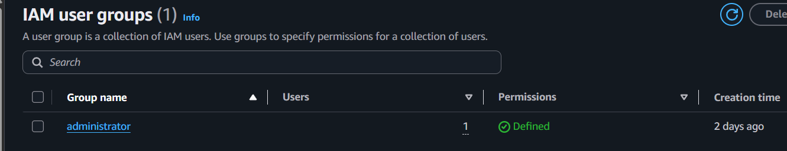


**Что разрешает политика AdministratorAccess? Почему нельзя использовать root для повседневной работы?**

`AdministratorAccess` даёт полный доступ ко всем сервисам и ресурсам аккаунта AWS (`Action: *`, `Resource: *`), кроме действий, доступных только root (закрытие аккаунта, смена плана поддержки и т. п.). Root обладает неограниченными правами, его нельзя ограничить политиками. Компрометация root-ключей означает полную потерю контроля над аккаунтом, поэтому root используют только для редких задач, а повседневно работают под IAM-пользователем с нужными правами.

### 1.2 Бюджет Zero spend

- Шаблон: Zero spend budget
- Имя: `ZeroSpend`
- Email: `<email>`

 **Скриншот: созданный бюджет ZeroSpend**
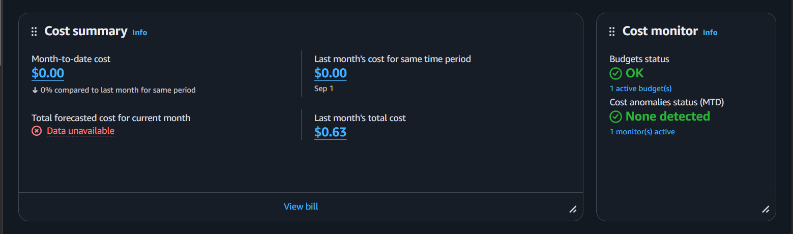

---

## Задание 2. Запуск экземпляра EC2

### Параметры

| Параметр | Значение |
|---|---|
| Name | `webserver` |
| AMI | Amazon Linux 2023 |
| Instance type | `t3.micro` |
| Key pair | `<nickname>-keypair`, ED25519, `.pem` |
| VPC | default, публичный IP включён |
| Security Group | `webserver-sg` |
| Inbound | SSH (My IP), HTTP (0.0.0.0/0) |
| Storage | по умолчанию |

### User data

```bash
#!/bin/bash
dnf -y update
dnf -y install htop nginx
systemctl enable --now nginx
```

 **Скриншот: настройки при запуске (Name, AMI, Instance type, Key pair)**

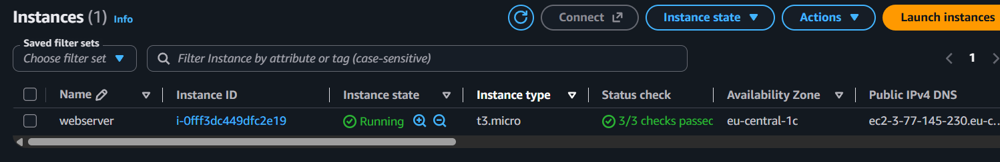

 **Скриншот: Security Group и правила входящего трафика**

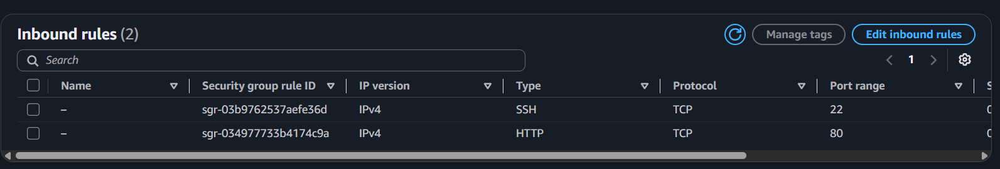

 **Скриншот: User data**

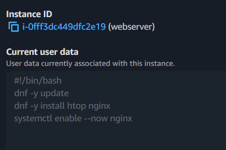


 **Скриншот: приветственная страница nginx в браузере**

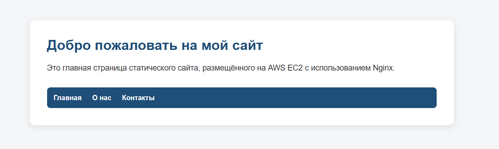

**Что такое User data и когда выполняется скрипт? Выполнится ли он после перезагрузки?**

User data — скрипт, который передаётся экземпляру при создании. Его выполняет сервис cloud-init при **первом** запуске. После обычной перезагрузки скрипт повторно **не** выполняется (nginx при этом запустится сам, так как включён через `systemctl enable`).

---

## Задание 3. Мониторинг и диагностика

### Status checks

 **Скриншот: вкладка Status and alarms**

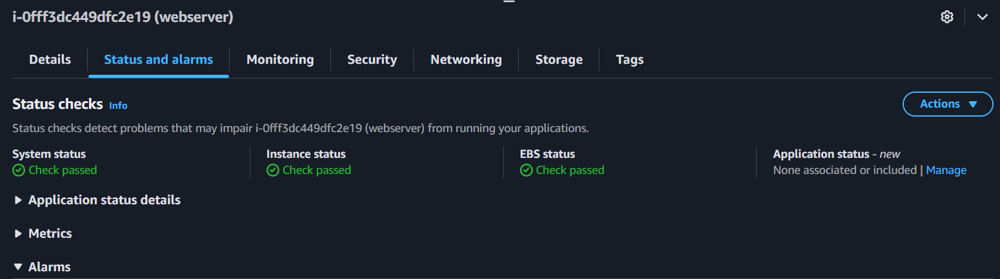

**Какая проверка указывает на проблему, которую можно исправить самому, а какая на проблему AWS?**

- **System status check** — проблема инфраструктуры AWS (физический сервер, сеть). Исправляет AWS; обычно помогает остановка и повторный запуск экземпляра (он переедет на другой хост).
- **Instance status check** — проблема самой ВМ (ОС не загрузилась, неверная сетевая конфигурация, исчерпана память). Это зона ответственности пользователя.
- **Attached EBS status check** — доступность подключённых томов EBS.

### Monitoring

 **Скриншот: вкладка Monitoring (CloudWatch)**

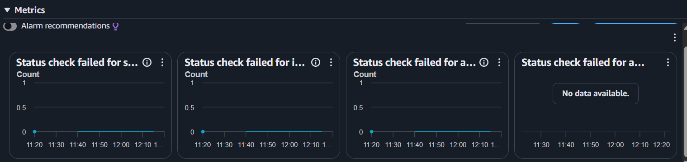

**В каких случаях стоит включать детальный мониторинг?**

Когда нужна быстрая реакция на изменения нагрузки: автомасштабирование (Auto Scaling), аларм по CPU, продакшен-системы с резкими пиками. Метрики приходят раз в минуту вместо пяти, но услуга платная. Для учебного сервера базового мониторинга достаточно.

---

## Задание 4. Подключение по SSH

Команды:

```bash
chmod 400 ~/.ssh/studen-key.pem
ssh -i ~/.ssh/studen-key.pemec2-user@3.77.145.230
systemctl status nginx
```

 **Скриншот: успешное подключение по SSH (приглашение `[ec2-user@ip-... ~]$`)**

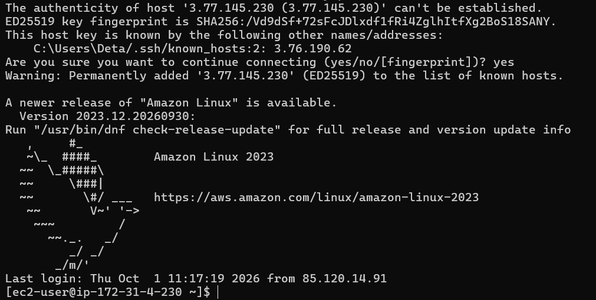


**Почему для входа используется ключ, а не пароль?**

Ключ (пара приватный/публичный) намного надёжнее пароля: его нельзя подобрать перебором, приватный ключ никогда не передаётся по сети, а на сервере хранится только публичная часть. Парольный вход на публичном сервере быстро становится целью брутфорс-атак.

---

## Задание 5. Статический сайт

Созданы файлы `index.html`, `about.html`, `contact.html` (папка [`site/`](site/)), страницы ссылаются друг на друга.

Команды:

```bash
# на локальном компьютере
ssh -i $HOME\.ssh\student-key.pem ec2-user@<3.76.190.62>

# на сервере
 scp -i $HOME\.ssh\student-key.pem index.html about.html contact.html ec2-user@3.76.190.62:~
```

 **Скриншот: выполнение **

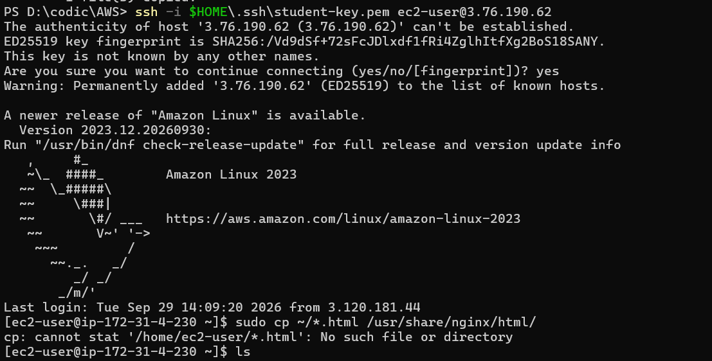

 **Скриншот:  на сервере**

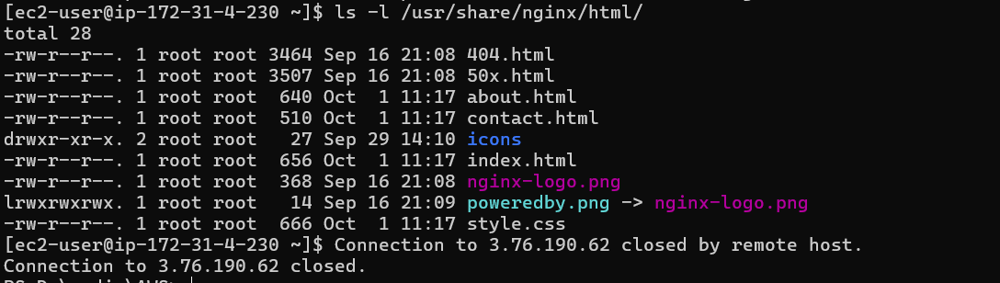

 **Скриншот: главная страница сайта в браузере**

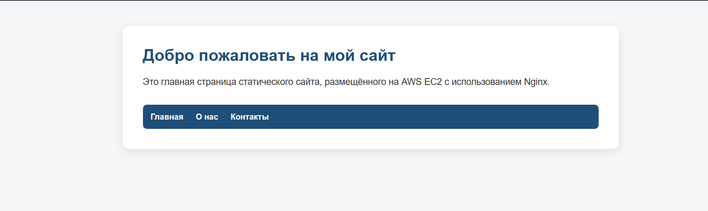


**Что делает `scp` и чем похожа на `ssh`?**

`scp` копирует файлы между локальной и удалённой машиной. Она работает поверх протокола SSH, использует тот же ключ (`-i`), тот же порт и то же шифрование, поэтому синтаксис подключения у них одинаковый (`user@host`).

---

## Задание 6. Остановка экземпляра через AWS CLI

Команда (CloudShell или локальный терминал):

```bash
$ aws ec2 stop-instances --instance-ids i-0fff3dc449dfc2e19 --region eu-central-1
```

**Скриншот: выполнение команды в CloudShell/терминале**

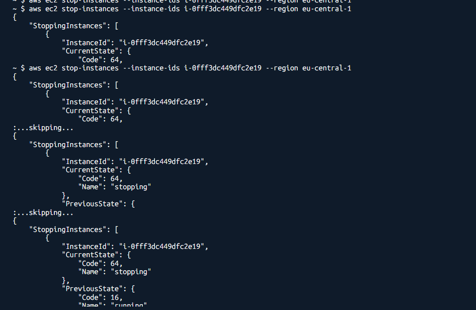

**Скриншот: экземпляр в состоянии Stopped**

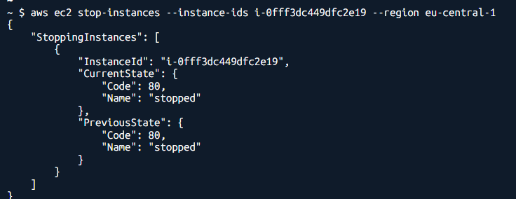

**Чем Stop отличается от Terminate? За что платим при остановленном экземпляре?**

- **Stop** — экземпляр выключается, диск (EBS) сохраняется, экземпляр можно запустить снова. Публичный IP при новом запуске меняется (если не Elastic IP).
- **Terminate** — экземпляр удаляется безвозвратно; корневой том по умолчанию тоже удаляется.

Пока экземпляр остановлен, плата за вычисления не взимается, но продолжается оплата за **тома EBS** (и за Elastic IP, если он привязан/зарезервирован).

---


## Выводы

В ходе работы я научился запускать виртуальную машину в Amazon EC2, настраивать Security Group, подключаться к ней по SSH-ключу и разворачивать на ней статический сайт на nginx. Также освоил диагностику (Status checks, CloudWatch, system log) и остановку экземпляра через AWS CLI.

Главное: доступ нужно ограничивать (IAM вместо root, SSH только с моего IP, вход по ключу), а остановленный экземпляр не оплачивается по вычислениям, но диск EBS продолжает стоить денег.
