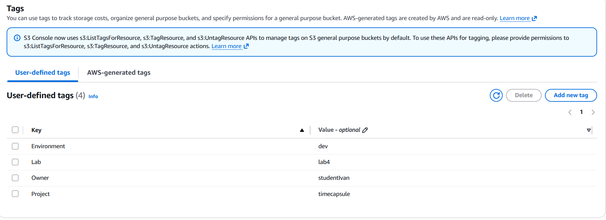
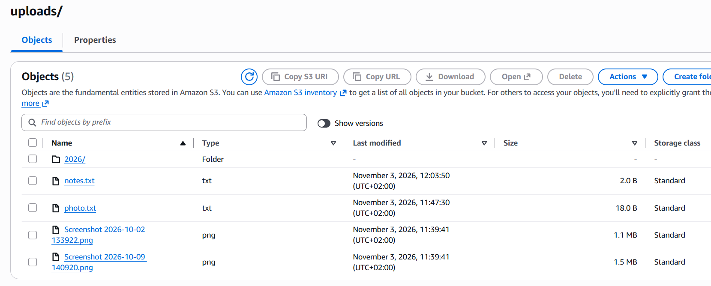
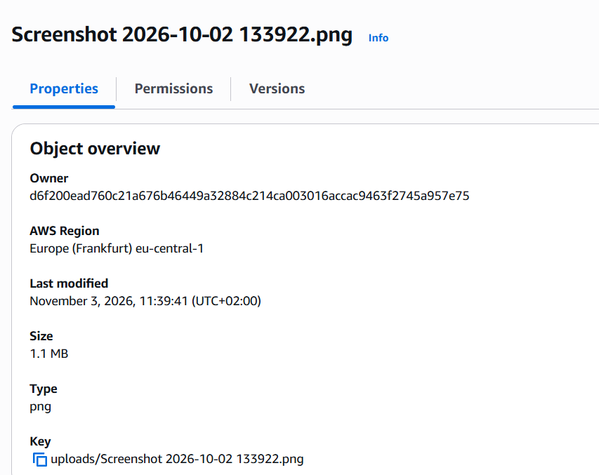
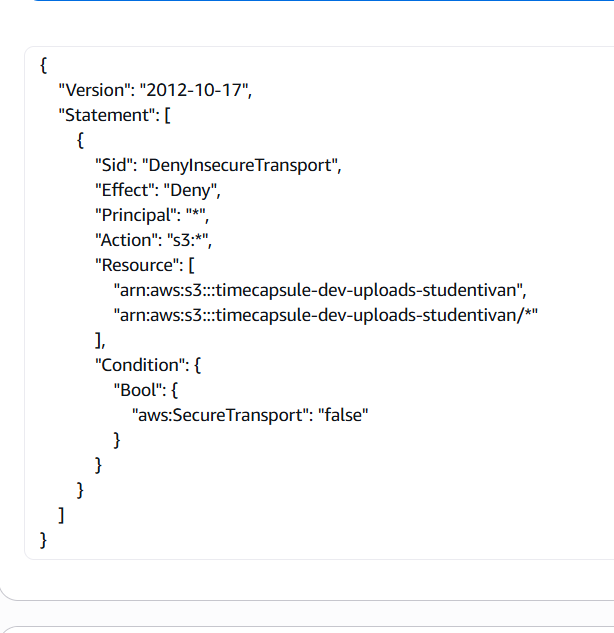
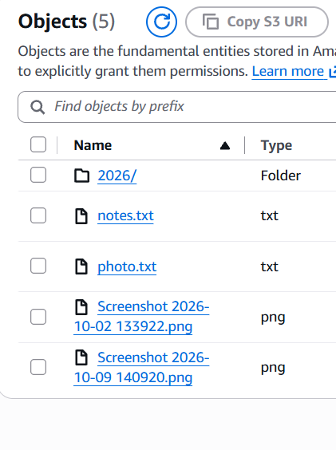
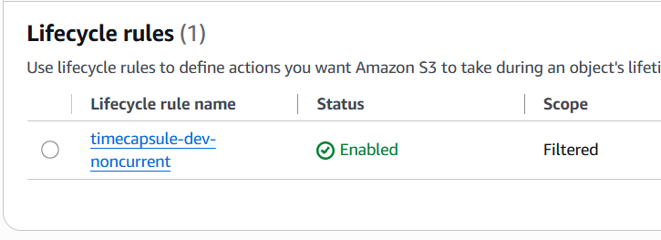

# Лабораторная работа №4

## Работа с Amazon S3 и управление объектами

**Студент:** Иван Болгарь
**Группа:** i-2402
------------------------------------------------------------------------

## Цель работы

Изучить работу Amazon S3, научиться создавать бакеты, загружать и
скачивать объекты, управлять версиями файлов, настраивать политики
доступа, Lifecycle Rules и временные ссылки Presigned URL.

## Используемые инструменты

-   AWS Management Console
-   Amazon S3
-   AWS CloudShell
-   AWS CLI
-   Браузер Google Chrome

**Регион AWS:** `eu-central-1` (Frankfurt)\
**Имя бакета:** `timecapsule-dev-uploads-studentivan`

------------------------------------------------------------------------

## Задание 1. Создание S3 Bucket и загрузка объектов

В AWS Management Console был создан бакет
`timecapsule-dev-uploads-studentivan`.

При создании были установлены следующие параметры:

-   Object Ownership --- ACLs disabled.
-   Block all public access --- включено.
-   Bucket Versioning --- изначально отключено.
-   Default encryption --- SSE-S3.
-   Регион --- `eu-central-1`.

Для бакета были добавлены теги:

  Key           Value
  ------------- -------------
  Project       timecapsule
  Environment   dev
  Owner         studentIvan
  Lab           lab4

В бакете были созданы две папки:

-   `uploads/` --- для изображений и PDF-файлов.
-   `backups/` --- для резервных файлов.

В папку `uploads/` были загружены изображение и PDF-файл, а в `backups/`
--- текстовый файл `backup.txt`.

После загрузки был открыт объект и проверены его свойства, включая
Object Key, Content-Type, ETag и Object URL.

**Результат:** бакет создан, объекты загружены, доступ к ним ограничен
настройками приватности бакета.

### Скриншоты

**Скриншот 1.1 --- Созданный бакет и его имя**


**Скриншот 1.2 --- Настройки доступа и шифрования бакета**


**Скриншот 1.3 --- Содержимое папок uploads и backups**



**Скриншот 1.4 --- Свойства загруженного объекта**


------------------------------------------------------------------------

## Задание 2. Работа с S3 через AWS CLI

Для выполнения команд был открыт AWS CloudShell.

Сначала была задана переменная с именем бакета:

``` bash
BUCKET=timecapsule-dev-uploads-studentivan
```

Была создана локальная структура каталогов и текстовые файлы:

``` bash
mkdir -p lab4/2026/10 && cd lab4

echo "photo placeholder" > photo.txt
echo "october report" > 2026/10/report.txt
echo "october report 2" > 2026/10/report-2.txt
```

Файл `photo.txt` был загружен в бакет:

``` bash
aws s3 cp photo.txt s3://$BUCKET/uploads/photo.txt
```

Для загрузки каталога использовалась команда:

``` bash
aws s3 sync 2026 s3://$BUCKET/uploads/2026
```

Для просмотра содержимого бакета использовались команды:

``` bash
aws s3 ls s3://$BUCKET

aws s3 ls s3://$BUCKET/uploads/

aws s3 ls s3://$BUCKET --recursive
```

Для проверки метаданных объектов использовалась команда:

``` bash
aws s3api head-object \
  --bucket $BUCKET \
  --key uploads/2026/10/report.txt
```

Для скачивания файла:

``` bash
aws s3 cp s3://$BUCKET/uploads/photo.txt downloaded.txt

cat downloaded.txt
```

Для удаления тестового файла:

``` bash
aws s3 rm s3://$BUCKET/uploads/2026/10/report-2.txt
```

**Результат:** выполнены загрузка, синхронизация, просмотр, проверка
метаданных, скачивание и удаление объектов с помощью AWS CLI.

------------------------------------------------------------------------

## Задание 3. Настройка Bucket Policy

Для бакета была создана политика, запрещающая выполнение операций с S3
через незащищённое HTTP-соединение.

В разделе **Permissions → Bucket policy** была добавлена следующая
политика:

``` json
{
  "Version": "2012-10-17",
  "Statement": [
    {
      "Sid": "DenyInsecureTransport",
      "Effect": "Deny",
      "Principal": "*",
      "Action": "s3:*",
      "Resource": [
        "arn:aws:s3:::timecapsule-dev-uploads-studentivan",
        "arn:aws:s3:::timecapsule-dev-uploads-studentivan/*"
      ],
      "Condition": {
        "Bool": {
          "aws:SecureTransport": "false"
        }
      }
    }
  ]
}
```

После сохранения политики была выполнена проверка доступа через AWS CLI.

Проверка HTTPS:

``` bash
aws s3 ls s3://$BUCKET/uploads/
```

Проверка HTTP:

``` bash
aws s3 ls s3://$BUCKET/uploads/ \
  --endpoint-url http://s3.eu-central-1.amazonaws.com
```

**Результат:** настроена политика, запрещающая использование
незащищённого HTTP-транспорта для доступа к объектам бакета.

### Скриншоты

**Скриншот 3.1 --- Добавленная Bucket Policy**



------------------------------------------------------------------------

## Задание 4. Включение Versioning и проверка удаления объектов

В разделе **Properties → Bucket Versioning** было включено
версионирование объектов.

Для проверки был создан текстовый файл `notes.txt` с содержимым:

``` text
v1
```

Файл был загружен в папку `uploads/`. Затем его содержимое было
изменено:

``` text
v2
```

После повторной загрузки файла с тем же именем Amazon S3 сохранил новую
версию объекта.

В разделе Objects была включена опция **Show versions**, после чего были
проверены доступные версии файла.

Затем было выполнено удаление объекта без отображения версий. После
этого при включённом **Show versions** был обнаружен Delete Marker.

Для проверки восстановления объекта Delete Marker был удалён. После
этого объект снова стал доступен.

В завершение была удалена последняя версия `v2`, после чего актуальной
стала предыдущая версия `v1`.

**Результат:** включено версионирование и проверена работа версий
объектов, Delete Marker и восстановления файла после удаления.

### Скриншоты

**Скриншот 4.2 --- Загрузка первой и второй версии файла**


**Скриншот 4.4 --- Восстановление предыдущей версии файла**



------------------------------------------------------------------------

## Задание 5. Настройка Lifecycle Rule

В разделе **Management → Lifecycle rules** было создано правило
автоматического управления старыми версиями объектов.

Параметры правила:

  Параметр                                           Значение
  -------------------------------------------------- ------------------------------
  Rule name                                          `timecapsule-dev-noncurrent`
  Prefix                                             `uploads/`
  Noncurrent version transition                      Standard-IA
  Переход в Standard-IA                              Через 30 дней
  Удаление старых версий                             Через 90 дней
  Количество сохраняемых новых неактуальных версий   2
  Очистка незавершённых multipart-загрузок           Через 7 дней

Правило ограничено объектами, находящимися в папке `uploads/`.

Оно позволяет автоматически переводить старые версии объектов в более
экономичный класс хранения, удалять устаревшие версии и очищать
незавершённые multipart-загрузки.

**Результат:** создано Lifecycle Rule с заданными параметрами
автоматического управления объектами.

### Скриншоты

**Скриншот 5.1 --- Создание Lifecycle Rule**



**Скриншот 5.2 --- Настройки перехода и удаления версий**


------------------------------------------------------------------------

## Задание 6. Создание Presigned URL

Для проверки временного доступа к приватным объектам была создана
Presigned URL.

Сначала ссылка была создана через AWS Management Console:

1.  Открыт объект в папке `uploads/`.
2.  Выбран пункт **Object actions**.
3.  Выбрана функция создания Presigned URL.
4.  Установлено время действия ссылки --- 5 минут.
5.  Ссылка была скопирована и проверена в режиме инкогнито браузера.

Затем ссылка была создана через AWS CLI:

``` bash
aws s3 presign s3://$BUCKET/uploads/photo.txt --expires-in 120
```

Дополнительно была создана ссылка для другого объекта:

``` bash
aws s3 presign s3://$BUCKET/uploads/notes.txt --expires-in 120
```

Срок действия второй ссылки был установлен на 120 секунд.

После проверки временных ссылок была выполнена очистка локальной рабочей
папки:

``` bash
cd ~
rm -rf lab4
```

**Результат:** выполнена генерация временных ссылок для доступа к
объектам приватного S3-бакета через консоль и AWS CLI.

### Скриншоты

**Скриншот 6.2 --- Создание ссылки через AWS CLI**


**Скриншот 6.3 --- Открытие объекта по временной ссылке в браузере**


------------------------------------------------------------------------

## Заключение

В ходе практической части лабораторной работы были изучены основные
возможности Amazon S3.

Был создан приватный S3-бакет, загружены и скачаны объекты через AWS
Management Console и AWS CLI. Была настроена политика безопасности,
запрещающая незащищённое HTTP-соединение. Также было включено
версионирование объектов, проверена работа Delete Marker и
восстановления предыдущих версий.

Дополнительно было создано Lifecycle Rule для автоматического управления
старыми версиями объектов и выполнена генерация временных Presigned URL.

В результате были освоены основные операции по хранению, защите и
управлению объектами в Amazon S3.

**Примечание:** данный отчёт охватывает Part 1 лабораторной работы. Part
2 (IAM Roles и AssumeRole) выполняется отдельно.
