# Отчёт по лабораторной работе 6. Часть 1. Базовый уровень

**Тема:** балансировщик нагрузки и группа Auto Scaling в AWS
**Регион:** eu-central-1 (Frankfurt)
**VPC:** timecapsule-dev-vpc (из ЛР3), подсети public-a и public-b
**Тег всех ресурсов:** `Lab = lab6`

---

## Подготовка. Группы безопасности

Созданы две группы безопасности в VPC из ЛР3:

- `lab6-alb-sg` принимает HTTP (порт 80) из любого места (0.0.0.0/0).
- `lab6-web-sg` принимает HTTP (порт 80) только от группы `lab6-alb-sg`, поэтому серверы доступны только через балансировщик.

[Правила lab6-alb-sg]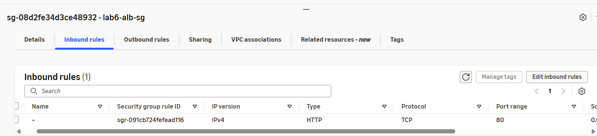

[Правила lab6-web-sg]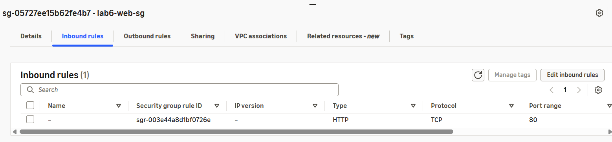

---

## Задание 1. Балансировщик

### 1.1 Целевая группа lab6-tg

Создана целевая группа `lab6-tg`: тип целей Instances, протокол HTTP, порт 80, VPC из ЛР3. Проверка работоспособности: протокол HTTP, путь `/health`, интервал 10 секунд.

[Настройки целевой группы lab6-tg]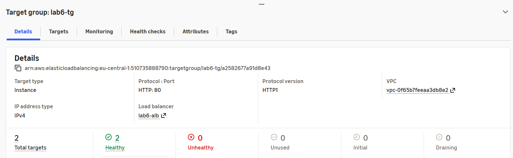

[Настройки проверки работоспособности]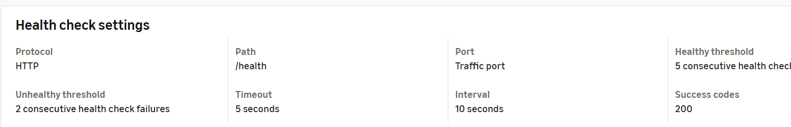
### 1.2 Балансировщик lab6-alb

Создан Application Load Balancer `lab6-alb` со схемой Internet-facing в подсетях public-a и public-b, с группой безопасности `lab6-alb-sg`. Добавлен listener HTTP:80, который передаёт запросы в `lab6-tg`.

[Сводка балансировщика lab6-alb (DNS name, зоны, группа безопасности)]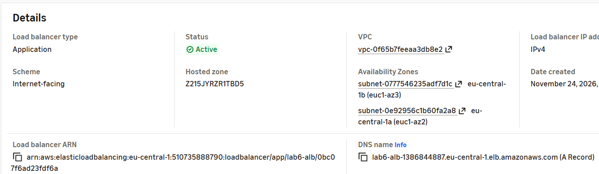

![Listener HTTP:80 с действием Forward to lab6-tg]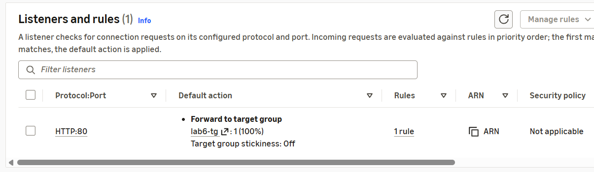

### 1.3 Проверка

DNS-имя балансировщика открыто в браузере. Пока в целевой группе нет серверов, балансировщик возвращает ошибку 503.

---

## Задание 2. Группа Auto Scaling

### 2.1 Шаблон запуска lab6-lt

Создан шаблон запуска `lab6-lt`: Amazon Linux 2023, тип t3.micro, пара ключей, группа безопасности `lab6-web-sg`, подсеть не указана. В поле User data вставлен скрипт, который устанавливает nginx и выводит на странице имя сервера и зону доступности. Скрипт также создаёт файл `/health` для проверки работоспособности.

[Шаблон запуска lab6-lt (AMI, тип, ключ, группа безопасности)]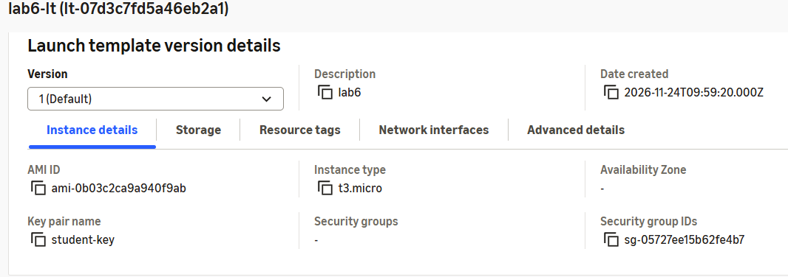

### 2.2 Группа lab6-asg

Создана группа `lab6-asg` из шаблона `lab6-lt`:

- подсети public-a и public-b;
- подключена к целевой группе `lab6-tg`;
- включены проверки ELB (Elastic Load Balancing health checks);
- размер группы: желаемое 2, минимальное 2, максимальное 4;
- политика target tracking по метрике Application Load Balancer request count per target со значением 50.

[Настройки сети и балансировки группы lab6-asg]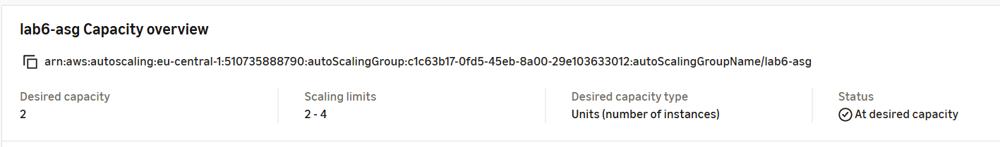

[Политика target tracking (Automatic scaling)]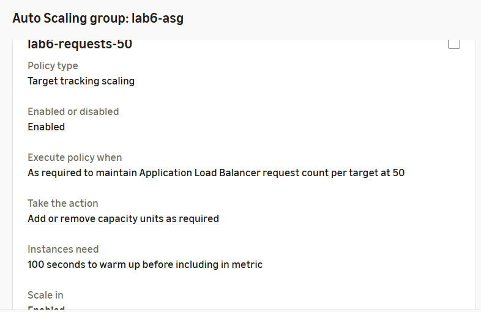

### 2.3 Проверка

Оба сервера в `lab6-tg` перешли в состояние healthy. При обновлении страницы балансировщика отвечают разные серверы из разных зон.

[Цели lab6-tg в состоянии healthy]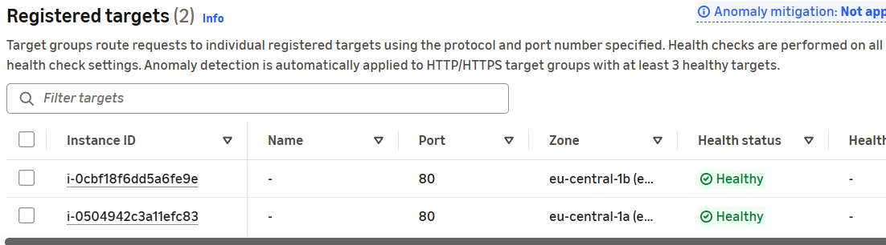

[Страница балансировщика, первый сервер]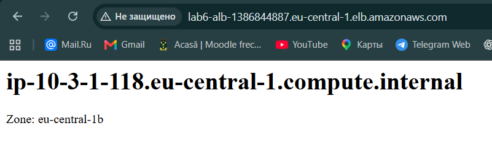

![Страница балансировщика, второй сервер]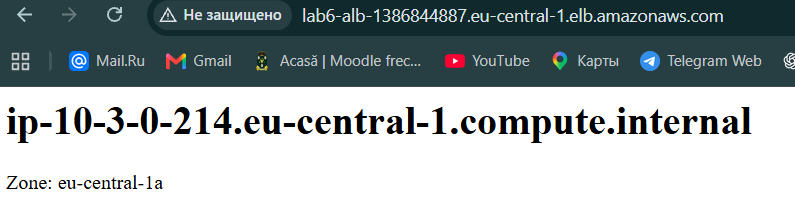

---

## Задание 3. Нагрузка

Запущен скрипт, который 10 минут подряд отправляет запросы на DNS-имя балансировщика.

[Запущенный скрипт нагрузки]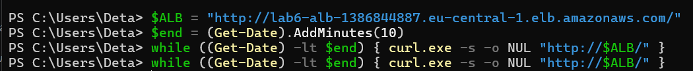

### 3.1 Тревоги CloudWatch

Политика target tracking создала две тревоги: AlarmHigh (добавляет серверы) и AlarmLow (убирает лишние). Во время нагрузки AlarmHigh перешла в состояние ALARM.

[Список тревог CloudWatch]![alt text]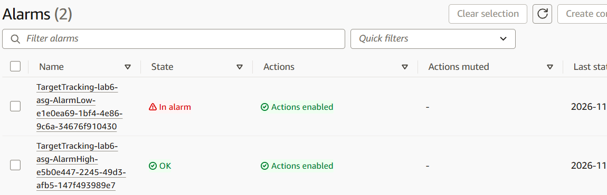

[График RequestCountPerTarget на странице AlarmHigh]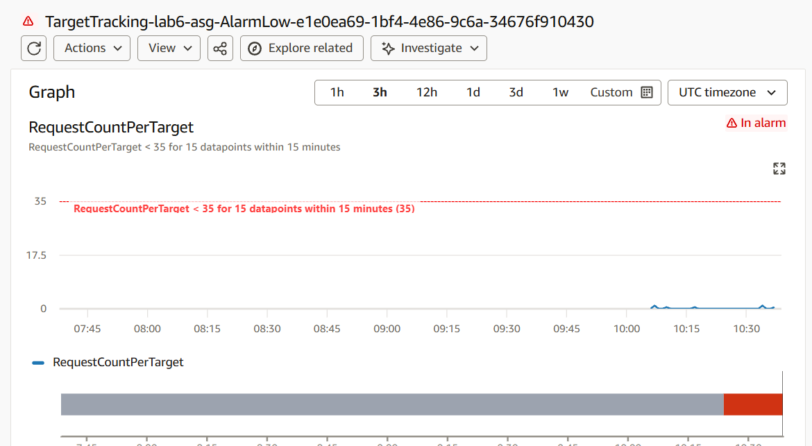

[Вкладка History тревоги AlarmHigh]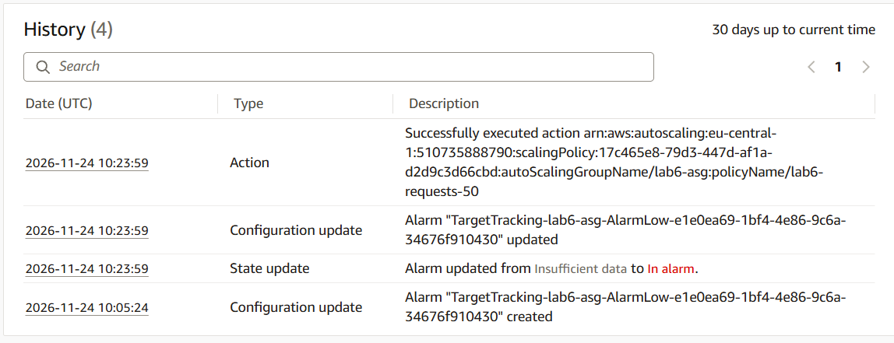

### 3.2 Возврат к двум серверам

После окончания нагрузки группа вернулась к двум серверам.

---

## Завершение

Удалены ресурсы в порядке: группа `lab6-asg` (серверы удалились вместе с ней), балансировщик `lab6-alb`, целевая группа `lab6-tg`, шаблон `lab6-lt`, группы безопасности `lab6-web-sg` и `lab6-alb-sg`.
---

## Ответы на вопросы

### Задание 1

**Какой ответ вернул балансировщик и почему?**
Ошибку 503 (Service Temporarily Unavailable). Балансировщик работает, но в целевой группе нет ни одного сервера, которому можно передать запрос.

**Зачем балансировщику подсети в двух зонах?**
Для отказоустойчивости. Если одна зона доступности выйдет из строя, балансировщик продолжит принимать запросы через вторую. Для ALB минимум две зоны обязательны.

### Задание 2

**Чем группа Auto Scaling отличается от целевой группы?**
Группа Auto Scaling создаёт и удаляет серверы и поддерживает нужное их количество. Целевая группа это список серверов, которым балансировщик передаёт запросы и здоровье которых он проверяет. Группа Auto Scaling сама регистрирует свои серверы в целевой группе.

**Почему в шаблоне нет подсети?**
Подсеть выбирает сама группа Auto Scaling, распределяя серверы по зонам. Если указать подсеть в шаблоне, все серверы оказались бы в одной зоне, и отказоустойчивость пропала бы.

### Задание 3

**Сколько серверов запустила группа и почему не больше четырёх?**
Группа запустила N серверов (указать число по вкладке Activity). Больше четырёх она не запускает, потому что максимальный размер группы равен 4: политика не может выйти за этот предел, даже если метрика остаётся выше целевого значения.

**Почему метрика упала после запуска новых серверов, хотя запросов не стало меньше?**
Метрика RequestCountPerTarget считает запросы на один сервер. Общий поток запросов остался прежним, но делится на большее число серверов, поэтому на каждый приходится меньше.

**Почему группа добавляет серверы быстрее, чем убирает?**
Нехватку мощности нужно закрывать быстро, иначе пользователи получат медленные ответы или ошибки. Лишний сервер только стоит денег, поэтому торопиться с удалением не нужно. AlarmHigh срабатывает за несколько минут, а AlarmLow ждёт около 15 минут устойчиво низкой нагрузки, чтобы не убирать серверы из-за кратковременного затишья и не запускать их снова.